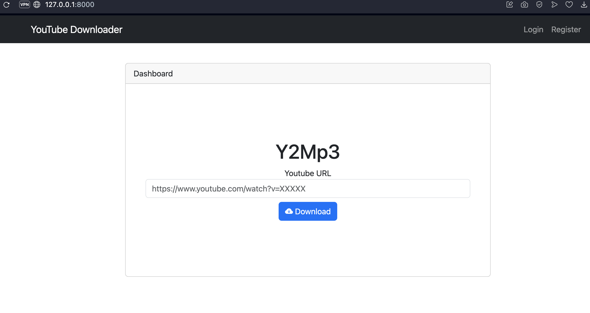
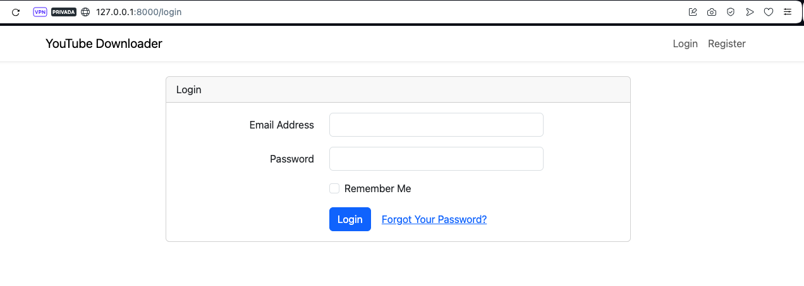

# YouTube Downloader PHP
Make your own YouTube Downloader Mp3 Site

## Requisites
* Linux
* php >= 8.4.1
* Laravel 12
* Web server
* Composer
* yt-dlp, latest release (https://github.com/yt-dlp/yt-dlp)
* Deno, the JavaScript runtime yt-dlp needs for YouTube (https://deno.com/)
* ffmpeg (https://ffmpeg.org/)


## Install ffmpeg, yt-dlp & Deno for video and audio conversions
### Linux (Ubuntu / Debian / WSL)
> **Don't install yt-dlp with `apt`.** The distribution package is usually outdated, and YouTube
> breaks old versions quickly (errors like `HTTP Error 400: Precondition check failed` or
> `Requested format is not available`).

Install ffmpeg from the distribution:
```bash
sudo apt install ffmpeg -y
```

If you previously installed yt-dlp with apt, remove it:
```bash
sudo apt remove yt-dlp -y
```

Install the official yt-dlp binary in `/usr/local/bin`, so every user, including the web server
user (`www-data`), can find it:
```bash
sudo curl -L https://github.com/yt-dlp/yt-dlp/releases/latest/download/yt-dlp_linux -o /usr/local/bin/yt-dlp
sudo chmod a+rx /usr/local/bin/yt-dlp
```

Install Deno system-wide:
```bash
curl -fsSL https://deno.land/install.sh | sudo DENO_INSTALL=/usr/local sh
```

Check the installation:
```bash
yt-dlp --version
deno --version
ffmpeg -version
```

Keep yt-dlp up to date. When downloads stop working, updating it is usually the fix:
```bash
sudo yt-dlp -U
```

### Mac
```bash
brew install ffmpeg yt-dlp deno
```
Update with `brew upgrade yt-dlp`.

## Install Website
Copy the distributed environment file and set up the DB variables
```bash
cp .env.example .env
```
SQLite is used by default. `DB_DATABASE` can be a path relative to the project root
(default `database/ydownload.sqlite`). Create the empty database file:
```bash
touch database/ydownload.sqlite
```
Run composer, set the key and run the migrations
```bash
composer install
php artisan key:generate
php artisan migrate
```

### Using the Makefile
The same steps are available as `make` targets (run `make` to list them all):
```bash
make system-deps   # ffmpeg, yt-dlp and Deno (Ubuntu / Debian / WSL, uses sudo)
make install       # composer, .env, APP_KEY, SQLite DB and migrations
make check         # show versions of php, yt-dlp, deno and ffmpeg
make ytdlp-update  # update yt-dlp when downloads stop working
make serve         # start the development server
make test          # run the tests
```

## Local test
```bash
php artisan serve
```


### Disable Auth in HomePage

Just comment this line __construct of HomeController.php
```php
//$this->middleware('auth');
```

